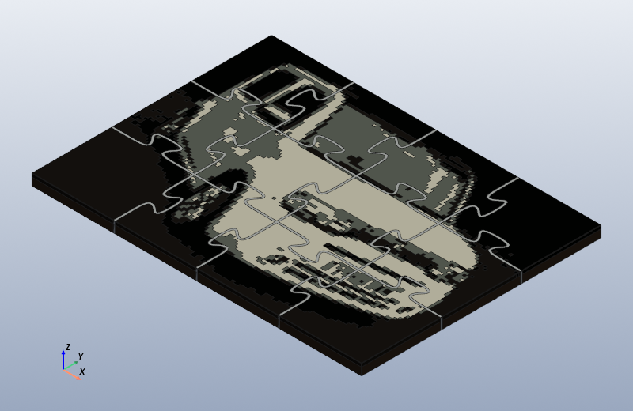
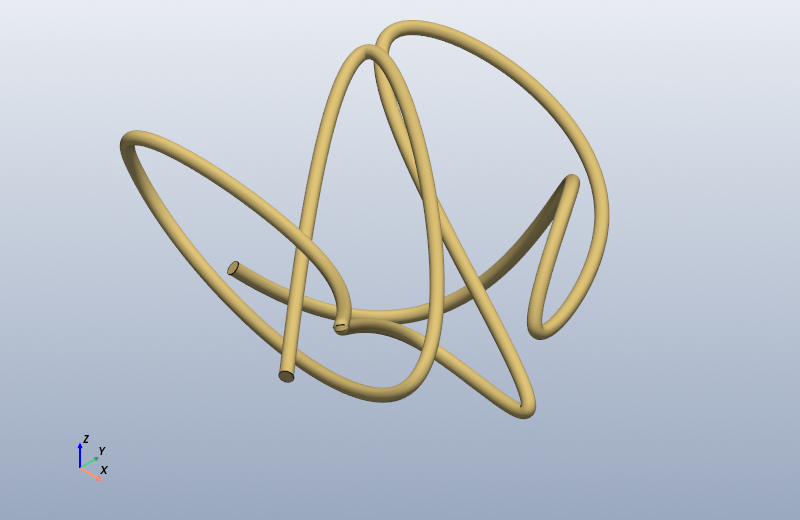

# Tiny-freecad

A tiny subset of the FreeCAD Python interface for embedding into projects. It's not complete, but it is large enough to be useful. 

|  |  |
|:---:|:---:|
| [Jigsaw Puzzle](examples/28%20Jigsaw%20Puzzle/JigsawPuzzle.md): a photo turned into a four-colour mosaic, cut into interlocking pieces | [Spaghetti Maker](examples/27%20Spaghetti%20maker/SpaghettiMaker.md): a tube swept along a smooth curve through random points |

Both made by unchanged FreeCAD scripts, run and shown by tiny-freecad
(`python -m tinyfreecad script.py`).

Scripts written for FreeCAD's Python console run unchanged in an ordinary
Python: `import FreeCAD`, `FreeCADGui`, `Part`, `Draft` and `Mesh` find
tiny-freecad's stand-ins, which build the shapes with
[manifold3d](https://github.com/elalish/manifold) instead of OpenCASCADE.
There's no FreeCAD to install, and the scripts run 10-20 times faster.
The result is what a 3D printer needs: closed, manifold triangle meshes,
written as STL files.

## Setting up

tiny-freecad needs Python 3.9 or later. It's best to install it into a
*virtual environment*: a private copy of Python inside this folder, so
its packages don't change the Python you already have. Do this once, in
the folder you cloned this repository into.

On Windows (PowerShell or Command Prompt):

```
py -m venv .venv
.venv\Scripts\activate
python -m pip install -r requirements.txt
```

If PowerShell refuses to run `activate` because running scripts is
disabled, run this once and then try again:
`Set-ExecutionPolicy -Scope CurrentUser RemoteSigned`.

On macOS or Linux:

```
python3 -m venv .venv
source .venv/bin/activate
python -m pip install -r requirements.txt
```

The last line installs the packages tiny-freecad needs, and tiny-freecad
itself. It also adds this folder to the environment's module search path
(that's the `-e .` line in `requirements.txt`), so any program run with
the environment's Python can `import FreeCAD`, wherever it is. Because
the install points at this folder rather than copying it, changes you make
here take effect straight away, with nothing to reinstall. If you move the
folder, run the last line again.

The prompt now starts with `(.venv)`, and `python` means the environment's
Python. Each time you open a new terminal, activate the environment again
with the second line above. Type `deactivate` to leave it.
To remove the environment completely, delete the `.venv` folder.

The setting only applies inside the virtual environment, so FreeCAD
itself is unaffected and still uses its own modules.

> **Tip: without the install.** To use tiny-freecad from another Python
> for a single terminal session, put this repository's folder on
> `PYTHONPATH`. That's the folder holding `FreeCAD.py`, `Part.py` and the
> rest, not the `tinyfreecad` folder inside it:
> `$env:PYTHONPATH = "D:\GitHub\Tiny-freecad"` in PowerShell,
> `set PYTHONPATH=D:\GitHub\Tiny-freecad` in Command Prompt,
> `export PYTHONPATH=~/Tiny-freecad` on macOS or Linux. Don't set it
> permanently for your whole account if you also use FreeCAD: FreeCAD's
> own Python reads it too, and would load tiny-freecad's `Part` and `Mesh`
> in place of its own.

## Running a script

With the environment active:

```
python -m tinyfreecad "examples/06 Desk Tidy/DeskTidy.py"
```

This runs the script and then opens a window showing what it made, the
way FreeCAD shows a document after running a macro:

- Every visible object is drawn where the script put it, in its
  `ViewObject.ShapeColor` and `Transparency`, with dark lines along the
  edges between faces. Objects with `Visibility` set to `False` are left
  out, such as the inputs of a `Part::Cut`.
- `Draft.make_text` labels appear as text.
- The view starts orthographic and isometric, fitted to the whole model.
  If the script asks for something else (`ActiveView.viewTop()`,
  `setCameraType("Perspective")`, `Gui.SendMsgToActiveView("ViewFront")`
  and so on), the window starts that way instead.
- FreeCAD's view keys work: `0` isometric, `1` front, `2` top, `3` right,
  `4` rear, `5` bottom, `6` left, `v` fit all. Drag with the left mouse
  button to rotate, with shift or the middle button to pan, and use the
  wheel to zoom.

If the script stops with an error, the error is printed and the window
shows whatever the script had made before it stopped, as FreeCAD does.

Options:

- `--watch` keeps the window open and runs the script again each time you
  save it, keeping the camera where you left it. Edit in one window, see
  the result in the other.
- `--stl FOLDER` writes every solid the script left in its documents to
  `FOLDER/<label>.stl`. Scripts that call `Mesh.export()` themselves write
  their own files, just as they do in FreeCAD.
- `--screenshot FILE.png` saves a picture of the view instead of opening a
  window (`ActiveView.saveImage(...)` in a script does the same).
- `--no-view` just runs the script, with no window (for batch runs).

From Python, `tinyfreecad.runner.run_script(path)` runs a script and
returns its documents, and `tinyfreecad.viewer.show()` opens the window
on the active document. Run from this folder (or with tiny-freecad
installed), `import FreeCAD as App` works directly.

## What's there

| Module | Supported |
|---|---|
| `FreeCAD` | `Vector`, `Matrix`, `Placement`, `Rotation`, `BoundBox`, `newDocument`, `ActiveDocument`, `closeDocument`, `getDocument`, `listDocuments`, `Console`; documents with `addObject` / `removeObject` / `getObject` / `Objects` / `recompute`; `Part::Feature`, `Part::Box`/`Cylinder`/`Cone`/`Sphere`, `Part::Cut`/`Fuse`/`Common`, groups; `ViewObject` colours, transparency and visibility (used by the view) |
| `Part` | `makeBox`, `makeCylinder`, `makeCone`, `makeSphere`, `makeTorus`, `makePlane`, `makeLine`, `makePolygon`, `makeCircle`, `makeCompound`, `makeLoft`, `show`; `LineSegment`, `Circle`, `Arc`/`ArcOfCircle`, `BSplineCurve` (`interpolate`, `buildFromPoles`); `Edge`, `Wire`, `Face` (with holes), `extrude`, `revolve`, `makePipeShell`; `fuse`, `cut`, `common`, `translate`, `rotate`, `scale`, `mirror`, `transformGeometry`, `Volume`, `Area`, `BoundBox`, `Solids`, `isNull`, `exportStl` |
| `Draft` | `make_text` / `makeText` (a label with no shape), `make_shapestring` / `makeShapeString` (TrueType/OpenType text as faces, kerned and sized like FreeCAD 1.0's) |
| `Mesh` | `export` (`.stl`, `.obj`), `Mesh.Mesh` (read STL, from triangles, `write`) |
| `FreeCADGui` | `ActiveDocument.ActiveView` view calls (`fitAll`, `viewIsometric`, `viewTop`, ... `setCameraType`, `saveImage`) and `SendMsgToActiveView`; they set up the window shown after the script (see above), and anything else is accepted and ignored |

Anything else raises `NotImplementedError` (or `AttributeError` for a
missing module function) that names what isn't supported. That includes
fillets and chamfers, the faces and edges of solids, and saving `.FCStd`
documents.

## How it differs from FreeCAD

- **Solids are meshes.** Curved surfaces are polygons that stay within
  0.02 mm of the true surface, with at least 48 sides to a circle. Volumes
  are typically within 0.3% of FreeCAD's, and bounds within a few
  hundredths of a millimetre. A solid has no B-rep faces or edges to pick
  out.
- **Wires and faces are exact** until they're extruded, swept or meshed.
- **Interpolated B-splines match OpenCASCADE's.** They use the same
  chord-length parameters, the same automatic end tangents, and the same
  tangent scaling, so `BSplineCurve.interpolate()` gives the same curve.
- **Sweeps** (`makePipeShell`) carry the profile on rotation-minimising
  frames, which is what OpenCASCADE's corrected-Frenet mode approximates.
  `isFrenet=True` and multi-section sweeps aren't supported. Lofts join
  sections with ruled surfaces.
- **Booleans** behave as OpenCASCADE's do on compounds: each member of a
  compound is cut on its own, so it stays a compound. Results report
  `ShapeType == "Compound"`, as FreeCAD's do.

## The examples

`examples/` holds the exercises from
[Python-in-FreeCAD](https://github.com/CrazyRobMiles/Python-in-FreeCAD),
with their write-ups and pictures. Each one runs in FreeCAD 1.0 and in
tiny-freecad. The scripts are the same as the originals, with two
exceptions:

- `18`–`21` add `import os`. FreeCAD's console has `os` already imported,
  but a plain Python doesn't.
- The image examples (`22`–`25`, `28`, `29`) find their files next to the
  script, so they work wherever the repository is. Each reads its picture
  from its own folder and writes its STL files (and preview pictures) to an
  `stl` folder beside the script, which git ignores. The originals used
  folders on the author's PC. These examples also need Pillow.

## Tests

```
python -m unittest discover tests
```

- `tests/test_kernel.py` checks the pieces: vectors, booleans, faces,
  curves, sweeps, documents and STL files.
- `tests/test_examples.py` runs every example with tiny-freecad. It
  compares each object it makes (name, label, shape type, number of
  solids, volume, area, bounding box, colour) and the files it writes
  against what FreeCAD 1.0.2 made, recorded in `tests/reference/`.
  `python tests/test_examples.py --report` prints a table of the
  differences.
- `python tests/make_reference.py [IDS]` re-records those references. It
  runs the examples inside FreeCAD's GUI (on `tests/freecad_side.py`),
  which closes itself when it has finished. Set `FREECAD_EXE`, or pass
  `--freecad`, if FreeCAD isn't in `C:\Program Files\FreeCAD 1.0`.

Both sides run the examples through `tests/harness.py`, which seeds
`random` so the random examples make the same shapes in each. It points
the image examples' `OUTPUT_FOLDER` at a scratch folder, so tests don't
write into `examples/`. That happens in the text it runs; the files
aren't touched. An example that fails in FreeCAD itself fails its test,
since matching a failure would test nothing.

## Licence

tiny-freecad is released under the [MIT License](LICENSE), as are the
example scripts. The examples' write-ups and pictures are under
[CC BY 4.0](https://creativecommons.org/licenses/by/4.0/); see
[examples/LICENSE.md](examples/LICENSE.md).


Have fun!

[Rob Miles](https://www.robmiles.com/)
